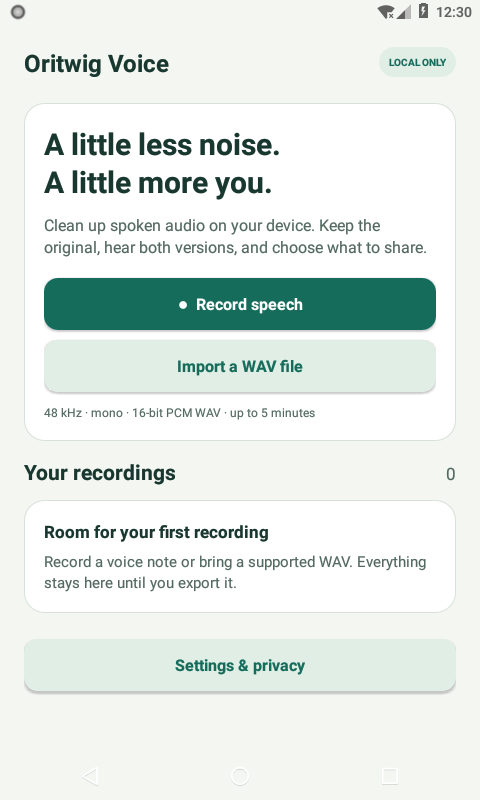

# Oritwig Voice

A local Android reference app for a speech-cleanup workflow, built around the **unchanged RNNoise engine and model used by Telegram**. No account or server needed.

- Record speech or import a supported WAV
- Keep and name the original; reduce background noise on-device
- Compare original/cleaned playback, seek, pause or loop
- Export either version through Android’s file picker

## See it working



[Comparison screen](docs/media/compare.png) · [Processing](docs/media/processing.png) · [Export complete](docs/media/exported.png) · [Microphone capture](docs/media/recording.png)


[Silent actual-screenshot walkthrough](docs/media/silent-screenshot-walkthrough.mp4) (21 seconds, no audio). This is a sequence of real screenshots, not a live screen recording or an audio-quality demo.

## Upstream versus this app

RNNoise is **Xiph/Mozilla and contributor work**, a third-party dependency vendored by Telegram. We use the [exact Telegram snapshot at f2908b](https://github.com/DrKLO/Telegram/tree/f2908b14133bbffbf7ab04f641ecb5bfaf533242/TMessagesProj/jni/voip/rnnoise), with all 21 files, DSP and default model unchanged.

[RNNoise upstream already provides a reusable C library and a raw-PCM example CLI](https://github.com/xiph/rnnoise#readme). The narrower reusable contribution here is the [Android RNNoise binding](https://github.com/athemeroy/oritwig-rnnoise/tree/1d48b939677621baf0c197dcf95ac0c10de088f6): four-ABI packaging (arm64-v8a, armeabi-v7a, x86 and x86_64), Java/JNI access, native-state lifecycle/reset and PCM16 conversion around the pinned engine. All denoising remains upstream RNNoise; no new denoiser, resampler or codec algorithm is added.

This app demonstrates that binding through opt-in capture, WAV import, named local originals, progress/cancellation, A/B listening and file-picker export. `WavIO` and `SpeechProcessor` are app utilities for WAV validation, file streaming and tested padding/flush/trim policy. They are separate from the engine and do not add audio-processing algorithms.

For a different integration scope, [rnnoise-kmp](https://github.com/Enaium/rnnoise-kmp#readme) documents Kotlin Multiplatform bindings, Android JNI packaging for the same four ABIs and an Android loopback example. Its platform claims come from its own documentation; we have not established its production maturity or run a comparative evaluation. Choose the binding and upstream snapshot that fit your project rather than assuming Oritwig is the only Android option.

Compared with Telegram, this is an independent file tool with no chats, calls, account system, Telegram UI or network stack. It reuses the RNNoise dependency, not Telegram’s application or capture pipeline. [Source identity and exact change boundary](docs/TECHNICAL.md).

## Limits and privacy

- **48 kHz, mono, 16-bit PCM WAV only**, up to 5 minutes / 32 MiB. Other rates, stereo and compressed audio are rejected, not converted
- Speech noise reduction only. No transcription, source separation or music restoration
- No internet permission, analytics or ads. Microphone access follows an in-app opt-in; leaving the app stops and saves capture
- Originals stay in app-private storage; backup/device transfer are disabled. Export a copy before uninstalling. A chosen export provider may upload using its own settings

Debug/release builds, lint, 9 JVM tests and 44 on-device checks pass. Real system-picker import/export, permission denial/grant and background capture save were verified. Real-speech cleanup quality, physical-microphone behavior and physical-device performance remain unproven; broader device testing is still open. These checks establish wrapper/workflow behavior, not an audio-quality or performance advantage over other RNNoise integrations. [Full verification and limits](docs/VALIDATION.md).

## Build and license

Android 8.0+. Build on Linux x86_64 with JDK21, SDK35/build-tools35.0.0, NDK27.2.12479018, SDK CMake3.22.1/Ninja and Python3. Set the SDK/JDK environment as shown in the [build guide](docs/TECHNICAL.md). The public engine submodule is pinned to commit `1d48b939677621baf0c197dcf95ac0c10de088f6`; no prebuilt AAR or credentials are required.

```sh
git clone --recurse-submodules https://github.com/athemeroy/oritwig-voice.git
cd oritwig-voice
bash tools/rebuild-engine.sh
./gradlew :app:assembleDebug :app:testDebugUnitTest :app:lintDebug
```

The manual CI workflow also checks out submodules recursively. GitHub’s automatic ZIP omits submodule contents; use a recursive clone or the self-contained corresponding-source bundle. The APK is a debug-signed V1 prototype. [Engine rebuild, hashes and instrumentation instructions](docs/TECHNICAL.md).

New shell/integration code: [BSD-3-Clause](LICENSE). RNNoise’s original per-file notices are retained in source and in Settings → About → Read license notices. No Telegram, Xiph or Mozilla endorsement is implied.
